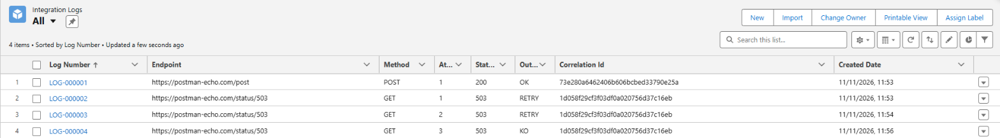

# Salesforce Integration Log & Retry

A small, production-style pattern for outbound REST integrations from Salesforce:

- **Every attempt is logged** in `Integration_Log__c`: endpoint, method, request, response, HTTP status, error, attempt number.
- **Transient failures are retried automatically**: timeouts, HTTP 429 and 5xx, up to 3 attempts, with a growing delay (1 min, then 2 min).
- **Client errors are not retried**: a 400 or 404 fails immediately as `KO`, because sending the same request again would fail again.
- **One correlation id per call**, shared by all its attempts and sent as the `X-Correlation-Id` header, so the logs can be matched with the external system's logs.
- **Usable from Apex and from Flow**, through the "Send to External API" action.



*Real run against Postman Echo: `LOG-000001` succeeds; the 503 call is retried after 1 and 2 minutes (same correlation id) and ends as `KO`.*

## How it works

```
Flow / Apex
    │  IntegrationService.send(recordId, endpoint, method, body)
    ▼
Queueable (Database.AllowsCallouts)
    │  HTTP callout
    ├── 2xx ───────────────────────────► log OK
    ├── timeout / 429 / 5xx, attempts left ─► log RETRY ─► re-queue with delay
    └── other 4xx, or last attempt ────► log KO
```

| Outcome | Meaning |
|---|---|
| `OK` | The call succeeded |
| `RETRY` | The call failed, another attempt is already queued |
| `KO` | The call failed for good: check `Error_Message__c` and `Response_Body__c` |

## What's inside

| Component | Purpose |
|---|---|
| `IntegrationService` | Queueable that sends the callout, logs it and decides whether to retry |
| `IntegrationInvocable` | Flow action "Send to External API" |
| `Integration_Log__c` | Log object, one record per attempt |
| `Integration_Log_Admin` | Permission set: read the logs and run the integration |
| `Postman_Echo` | Remote Site Setting for the public echo API used in the demo |
| `IntegrationServiceTest` | Tests with an HTTP mock: success, server error, client error, timeout, last attempt, input validation, Flow action |

## Try it

Deploy it to a free Developer Edition org or a scratch org:

```bash
sf project deploy start --target-org <your-dev-org> --test-level RunLocalTests
sf org assign permset --name Integration_Log_Admin --target-org <your-dev-org>
```

Then, from Anonymous Apex:

```apex
IntegrationService.send(null, 'https://postman-echo.com/post', 'POST', '{"orderId": 42}');
IntegrationService.send(null, 'https://postman-echo.com/status/503', 'GET', null);
```

Open the **Integration Logs** tab: the first call is `OK`. The second one is logged as `RETRY`, retried after 1 and 2 minutes, and ends as `KO`.

## Using it for a real integration

Replace the Remote Site Setting with a **Named Credential** and pass `callout:My_Named_Credential/path` as the endpoint. Authentication then stays out of the code.

## Known limits

- One Queueable per call: a single transaction can queue at most 50 calls, the Apex limit on enqueued jobs. For bulk loads, group the records into one job.
- Request and response bodies are stored up to 131,072 characters.
